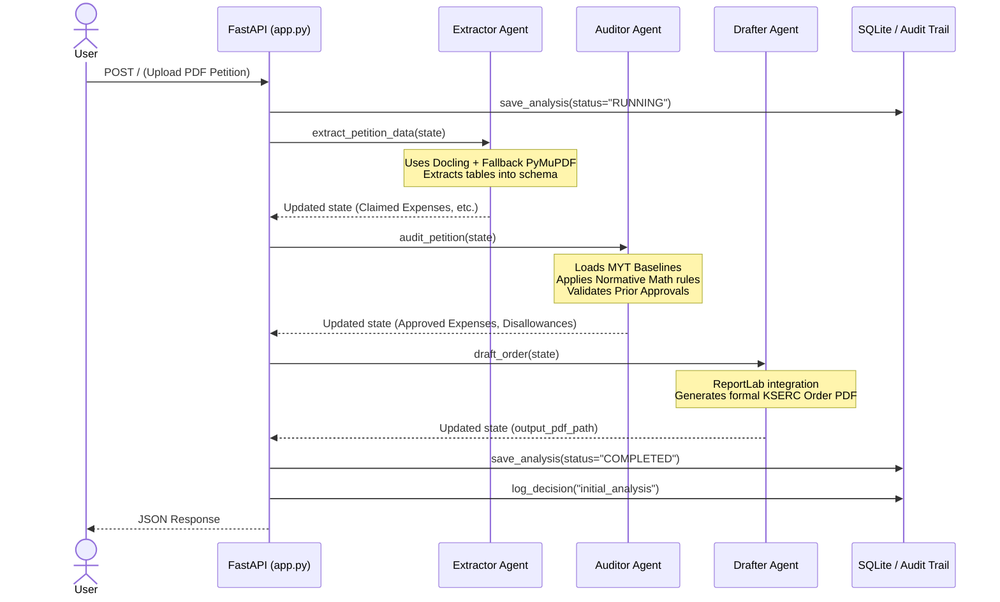

# KSERC SDL Truing-Up Platform: Agent Flow Architecture

This document describes the flow of data through the Multi-Agent System (MAS) built on LangGraph.

## High-Level Topology

The system uses a sequential agentic pipeline:

1. **Extraction Agent (`src/agents/extractor.py`)** -> 
2. **Audit & Compliance Agent (`src/agents/auditor.py`)** -> 
3. **Drafting Agent (`src/agents/drafter.py`)**

---

### Sequence Diagram

## Agent Details

### 1. Extractor Agent
- Receives the raw uploaded PDF.
- Uses `docling` to extract structured representations of the document (especially tables).
- Falls back to `fitz` (PyMuPDF) text parsing when table extraction fails.
- Uses regex heuristics to identify key financial components like "Purchase of Power", "Employee Cost", "Interest", and "Distribution Loss".

### 2. Auditor Agent
- Central compliance engine.
- Relies on determinisitic python functions in `normative_math.py`.
- **Key Rules Enforced:**
  - *Distribution Loss Penalty:* Comparing actual losses against target losses.
  - *O&M Escalation:* Capping Employee Cost and A&G Expenses utilizing 70:30 CPI/WPI indices.
  - *Section 3(1) Duty:* Automatic total rejection.
  - *Depreciation 90% Cap:* Enforcing maximum depreciation limit.
  - *Prior Approval Checks:* Rejecting capital expenditure without commission consent.

### 3. Drafter Agent
- Document generation engine.
- Uses ReportLab to generate a heavily styled PDF.
- Embeds a table comparing `Claimed` vs `Approved` expenses.
- Iterates over the `disallowance_log` from the Auditor Agent to dynamically generate legally-sound justifications for adjustments.
- Computes final "Revenue Gap/Surplus" tables and appends Chairman/Member signatures.

## Human-in-the-Loop Override Flow

When an auditor manually alters an approved amount through the (`/api/override`) endpoint:

1. The JSON state is fetched from SQLite.
2. The specific component's `approved_amount` is modified.
3. The `drafter.py` agent is implicitly invoked again to redraw the PDF with the updated math.
4. The change is logged via `log_decision` in `audit_trail.py` tying the override to the auditor's `user_id`.
